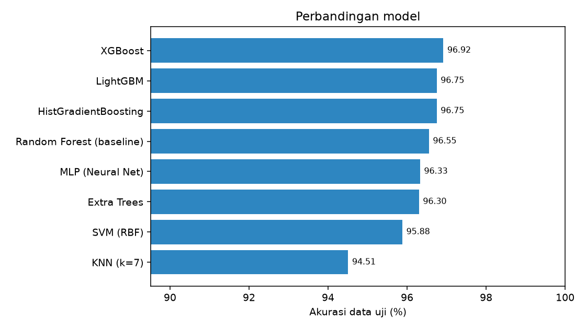
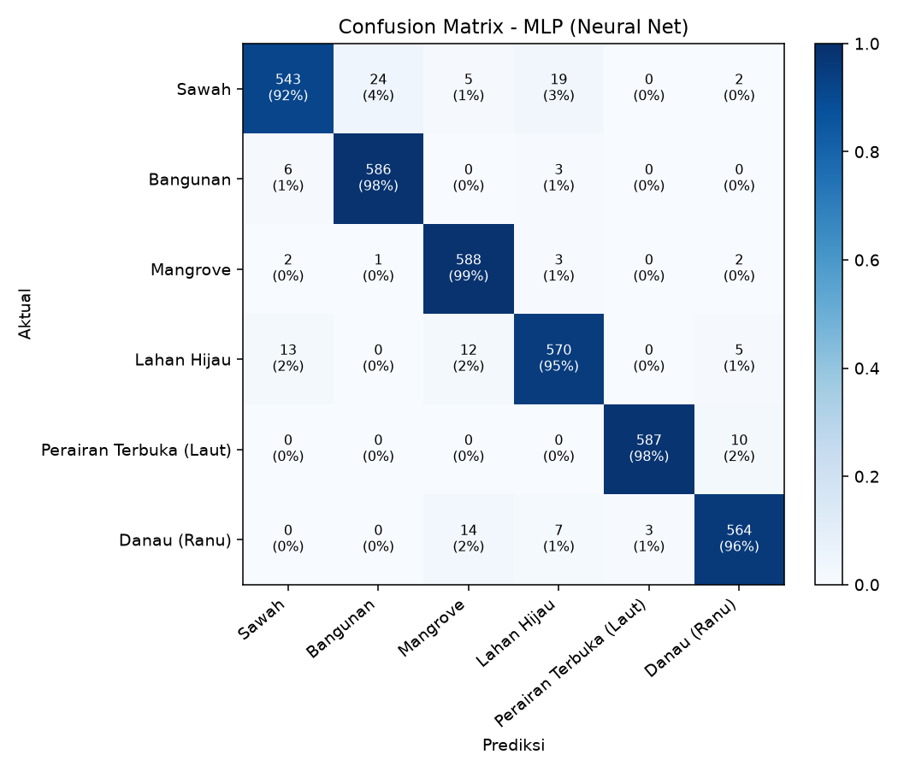
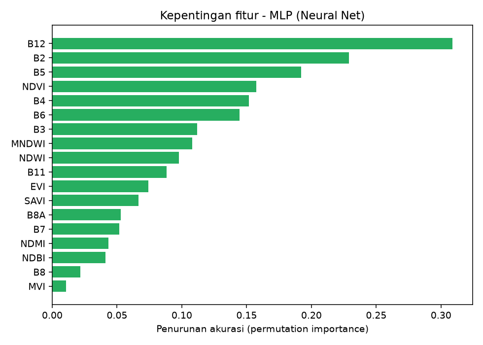
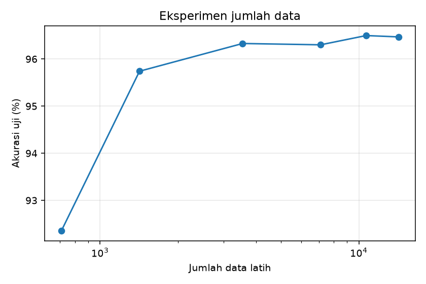
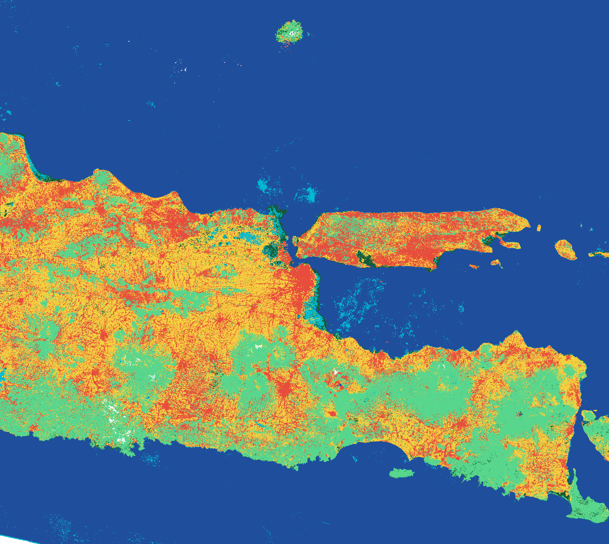

# Klasifikasi Penggunaan Lahan Jawa Timur (Sentinel-2A)

## 1. Data Understanding dan Tujuan Analisis

- Memetakan penutup/penggunaan lahan (land use & land cover, LULC) Provinsi Jawa Timur dari citra Sentinel-2A menjadi 6 kelas: sawah, bangunan, mangrove, lahan hijau, perairan terbuka (laut), dan danau (ranu).
- Membandingkan beberapa algoritma klasifikasi terbimbing (Random Forest sebagai baseline, XGBoost, LightGBM, SVM, dll.) dan memilih model dengan akurasi tertinggi.
- Menyajikan hasil klasifikasi sebagai sistem informasi geografis berbasis web (Folium/Leaflet di Streamlit) di atas basemap satelit Google, sebagai dasar analisis spasial penggunaan lahan dan kebijakan tata ruang (mis. pemantauan alih fungsi sawah, perlindungan mangrove, dan kawasan terbangun).

## 2. Pengumpulan Data

1. **Label**: 6 file GeoJSON poligon sampel, masing-masing 60 poligon (total 360), tersebar di Jawa Timur.
2. **Citra**: Sentinel-2A Level-2A (`COPERNICUS/S2_SR_HARMONIZED`) di Google Earth Engine, tahun 2025, filter `SPACECRAFT_NAME = Sentinel-2A`, masking awan Cloud Score+ (cs_cdf >= 0,6), komposit median, reflektansi dibagi 10.000.
3. **Ekstraksi**: 50 titik acak per poligon (10 m), nilai 10 band dan 8 indeks per titik, diekspor ke CSV.
4. **Pembersihan**: buang nilai kosong/tak hingga, batasi indeks rasio (EVI, MVI), seimbangkan jumlah titik per kelas.
5. **Pembagian data**: train/test dipisah *per poligon* (80:20) untuk mencegah kebocoran spasial.

## 3. Band Sentinel-2A

| Band | Nama | Panjang gelombang (nm) | Resolusi (m) | Kegunaan | Dipakai |
|---|---|---|---|---|---|
| B1 | Coastal aerosol | 442.7 | 60 | Koreksi aerosol atmosfer, perairan pesisir | Tidak |
| B2 | Blue | 492.4 | 10 | Pembeda air jernih, tanah, vegetasi; penyusun EVI | Ya |
| B3 | Green | 559.8 | 10 | Puncak pantulan vegetasi hijau; NDWI/MNDWI/MVI | Ya |
| B4 | Red | 664.6 | 10 | Penyerapan klorofil; NDVI/EVI/SAVI | Ya |
| B5 | Vegetation red edge 1 | 704.1 | 20 | Kondisi/kandungan klorofil vegetasi | Ya |
| B6 | Vegetation red edge 2 | 740.5 | 20 | Struktur kanopi, pembeda tipe vegetasi | Ya |
| B7 | Vegetation red edge 3 | 782.8 | 20 | Struktur kanopi, biomassa | Ya |
| B8 | NIR | 832.8 | 10 | Pantulan tinggi vegetasi, serapan air | Ya |
| B8A | Narrow NIR | 864.7 | 20 | NIR sempit, sensitif terhadap vegetasi | Ya |
| B9 | Water vapour | 945.1 | 60 | Koreksi uap air atmosfer | Tidak |
| B10 | SWIR - Cirrus | 1373.5 | 60 | Deteksi awan cirrus (tidak ada di produk L2A) | Tidak |
| B11 | SWIR 1 | 1613.7 | 20 | Kadar air tanah/vegetasi, lahan terbangun; NDBI/MNDWI/NDMI | Ya |
| B12 | SWIR 2 | 2202.4 | 20 | Pembeda tanah terbuka, lahan terbangun, air | Ya |

B1, B9, B10 tidak dipakai (koreksi atmosfer/deteksi awan, resolusi 60 m; B10 tidak ada di produk L2A).

## 4. Skema Kelas dan Acuan Klasifikasi Lahan Indonesia

Mengacu pada SNI 7645-1:2014 dan klasifikasi penutup lahan KLHK (23 kelas), diagregasi menjadi 6 kelas.

| ID | Kelas | Warna | Padanan klasifikasi Indonesia |
|---|---|---|---|
| 1 | Sawah | Kuning | Sawah (pertanian lahan basah) - kelas 'Sawah' KLHK |
| 2 | Bangunan | Merah | Permukiman / lahan terbangun - kelas 'Permukiman' KLHK; 'Daerah terbangun' SNI 7645 |
| 3 | Mangrove | Hijau Tua | Hutan mangrove (primer/sekunder) - kelas 'Hutan Mangrove' KLHK |
| 4 | Lahan Hijau | Hijau Muda | Gabungan vegetasi non-sawah: hutan lahan kering, perkebunan, pertanian lahan kering, semak belukar, padang rumput |
| 5 | Perairan Terbuka (Laut) | Biru Tua | Tubuh air - perairan laut (SNI 7645: 'Perairan') |
| 6 | Danau (Ranu) | Biru Muda | Tubuh air - perairan darat/danau (SNI 7645: 'Perairan') |

## 5. Fitur dan Rumus

Total 18 fitur: 10 band (B2, B3, B4, B5, B6, B7, B8, B8A, B11, B12) dan 8 indeks.

| Fitur | Rumus | Keterangan |
|---|---|---|
| NDVI | `(B8 - B4) / (B8 + B4)` | Normalized Difference Vegetation Index. Tinggi pada vegetasi lebat (mangrove, lahan hijau), rendah/negatif pada air dan bangunan. |
| NDWI | `(B3 - B8) / (B3 + B8)` | Normalized Difference Water Index (McFeeters). Positif pada badan air. |
| MNDWI | `(B3 - B11) / (B3 + B11)` | Modified NDWI (Xu). Lebih baik memisahkan air dari lahan terbangun. |
| NDBI | `(B11 - B8) / (B11 + B8)` | Normalized Difference Built-up Index. Tinggi pada area terbangun. |
| NDMI | `(B8 - B11) / (B8 + B11)` | Normalized Difference Moisture Index. Kelembapan vegetasi; membantu pembeda sawah tergenang. |
| EVI | `2.5 * (B8 - B4) / (B8 + 6*B4 - 7.5*B2 + 1)` | Enhanced Vegetation Index. Tidak mudah jenuh pada vegetasi rapat; reflektansi skala 0-1. |
| SAVI | `1.5 * (B8 - B4) / (B8 + B4 + 0.5)` | Soil Adjusted Vegetation Index (L = 0,5). Mengurangi pengaruh latar tanah. |
| MVI | `(B8 - B3) / (B11 - B3)` | Mangrove Vegetation Index (Baloloy dkk., 2020). Menonjolkan mangrove terhadap vegetasi lain. Nilai dibatasi -20 s.d. 20. |

## 6. Jumlah Data dan Kelas

Jumlah kelas **6**, data latih **14227**, data uji **3569**.

| Kelas | Poligon | Titik (bersih) | Train | Test |
|---|---|---|---|---|
| Sawah | 60 | 3000 | 2373 | 593 |
| Bangunan | 60 | 3000 | 2371 | 595 |
| Mangrove | 60 | 3000 | 2370 | 596 |
| Lahan Hijau | 60 | 2966 | 2366 | 600 |
| Perairan Terbuka (Laut) | 60 | 3000 | 2369 | 597 |
| Danau (Ranu) | 60 | 3000 | 2378 | 588 |

## 7. Perbandingan Model

| Model | CV akurasi (%) | Akurasi uji (%) | F1-macro uji (%) | Kappa |
|---|---|---|---|---|
| Random Forest (baseline) | 91.22 ± 1.75 | 96.55 | 96.55 | 0.9586 |
| Extra Trees | 91.41 ± 1.76 | 96.30 | 96.29 | 0.9556 |
| HistGradientBoosting | 91.92 ± 1.57 | 96.75 | 96.74 | 0.9610 |
| SVM (RBF) | 92.72 ± 1.80 | 95.88 | 95.87 | 0.9506 |
| KNN (k=7) | 90.26 ± 2.45 | 94.51 | 94.48 | 0.9341 |
| MLP (Neural Net) (terbaik) | 92.97 ± 1.84 | 96.33 | 96.32 | 0.9560 |
| XGBoost | 92.19 ± 1.54 | 96.92 | 96.91 | 0.9630 |
| LightGBM | 92.13 ± 1.52 | 96.75 | 96.74 | 0.9610 |

Model terbaik (dipilih dari CV data latih): **MLP (Neural Net)**, akurasi uji **96.33%**, kappa **0.9560**.

## 8. Evaluasi Model Terbaik

## 9. Eksperimen Jumlah Data

| Fraksi data latih | Jumlah | Akurasi uji (%) |
|---|---|---|
| 5% | 708 | 92.35 |
| 10% | 1420 | 95.74 |
| 25% | 3554 | 96.33 |
| 50% | 7112 | 96.30 |
| 75% | 10667 | 96.50 |
| 100% | 14227 | 96.47 |

## 10. Hasil Klasifikasi dan Luas Kelas

| Kelas | Luas (ha) |
|---|---|
| Sawah | 2,083,511 |
| Bangunan | 1,456,680 |
| Mangrove | 111,165 |
| Lahan Hijau | 1,920,501 |
| Perairan Terbuka (Laut) | 9,211,124 |
| Danau (Ranu) | 146,830 |

Luas bersifat indikatif karena dihitung dari raster kasar.
